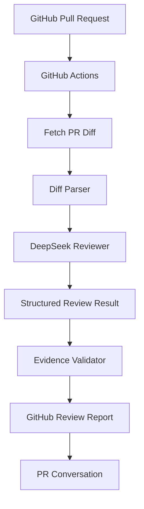
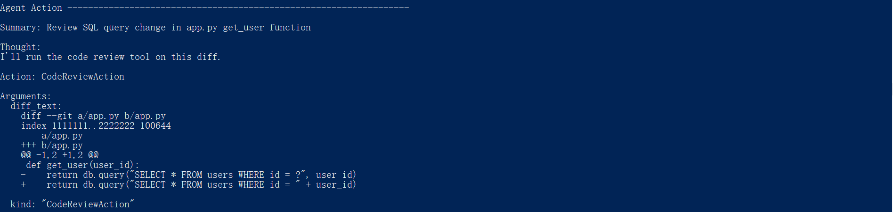
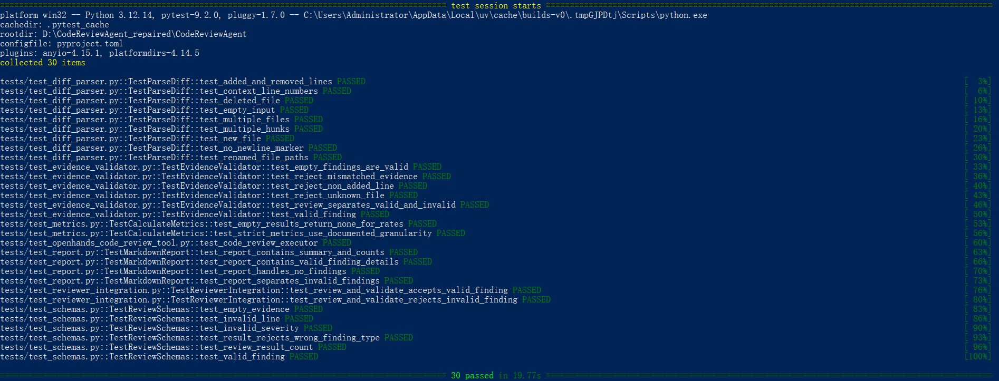

# OpenHands AI Code Review Agent

An AI-powered code review agent built with Python and DeepSeek, designed to analyze Git diffs, identify potential bugs and code risks, validate review evidence, and automatically publish structured review reports to GitHub Pull Requests.

> **Project status:** Standalone MVP completed. OpenHands integration is planned as the next development phase.

## Overview

Code reviews are essential for software quality, but manual reviews can be time-consuming and may overlook potential issues.

This project explores how an AI Agent can assist code review by:

- Analyzing Git diff changes.
- Identifying potential bugs, security concerns, and maintainability issues.
- Generating structured review findings with severity, evidence, and suggestions.
- Validating review findings against changed code.
- Integrating with GitHub Actions to automatically review Pull Requests.
- Publishing AI-generated review reports directly to GitHub PR conversations.

The project is developed as a standalone Python Agent first, with OpenHands integration planned for a later phase.

## Architecture



### Core Components

| Component | Responsibility |
|---|---|
| Diff Parser | Parse unified Git diffs and track changed lines |
| Reviewer | Send code changes to the DeepSeek API and generate review findings |
| Review Schema | Define structured review results and severity levels |
| Evidence Validator | Validate file paths, line numbers, and evidence |
| Evaluation | Measure review performance against curated test cases |
| GitHub Actions | Automate tests and AI review for Pull Requests |
| PR Review Publisher | Publish structured review reports to GitHub |

## Tech Stack

- Python 3.12
- DeepSeek API
- GitHub REST API
- GitHub Actions
- pytest
- uv

## Features

### 1. Git Diff Parsing

- Parse unified Git diff format.
- Support multiple files and hunks.
- Track old and new line numbers.
- Handle added and deleted files.

### 2. AI-Powered Code Review

The Agent analyzes code changes and generates structured findings, including:

- Potential bugs
- Security risks
- Maintainability issues
- Severity levels
- Evidence
- Suggested fixes

### 3. Evidence Validation

Review findings are validated against the source diff to reduce unsupported or incorrectly located findings.

### 4. Automated GitHub PR Review

The GitHub Actions workflow:

1. Runs tests for Pull Requests.
2. Fetches the PR diff.
3. Invokes the AI review Agent.
4. Validates review findings.
5. Publishes the review report to the PR conversation.

### 5. Fork PR Security

The workflow separates testing from AI review:

- Tests run for all Pull Requests, including Fork PRs.
- AI review runs only for Pull Requests originating from the same repository.
- The DeepSeek API key is not exposed to Fork PR workflows.

## Example Review Output

```json
{
  "findings": [
    {
      "issue_type": "bug",
      "severity": "high",
      "file_path": "src/example.py",
      "line_number": 42,
      "evidence": "potentially problematic code",
      "reason": "This code may lead to unexpected behavior.",
      "suggestion": "Validate the input before processing."
    }
  ]
}
```

This is an illustrative example of the report structure.

## Evaluation

The project includes a curated evaluation dataset with **15 test cases**.

The current evaluation results achieved 100% on this specific test set after iterative fixes.

> This result applies only to the current curated evaluation dataset. It should not be interpreted as general code review accuracy.

Evaluation focuses on:

- Review finding validation
- Evidence localization
- Structured output correctness
- Expected issue detection

## Getting Started

### Prerequisites

- Python 3.12
- Git
- DeepSeek API key

### Install

```bash
git clone https://github.com/WeCream/openhands-ai-code-review-agent.git

cd openhands-ai-code-review-agent

python -m venv .venv
```

Activate the virtual environment.

Windows PowerShell:

```powershell
.\.venv\Scripts\Activate.ps1
```

Install the project:

```bash
pip install -e .
pip install pytest
```

### Run Tests

```bash
python -m pytest tests -q
```

### Configure GitHub Actions

Add the following repository secret:

```text
DEEPSEEK_API_KEY
```

GitHub Actions uses this secret to invoke the DeepSeek API during eligible Pull Request reviews.

Never commit API keys or secrets to the repository.

## Project Structure

```text
.
├── src/
│   ├── diff_parser.py
│   ├── schemas.py
│   ├── reviewer.py
│   ├── evidence_validator.py
│   └── metrics.py
├── tests/
├── samples/
│   └── eval_cases.json
├── scripts/
│   └── run_pr_review.py
├── .github/
│   └── workflows/
│       └── pr-review.yml
├── run_eval.py
└── README.md
```

## Demo

### 1. OpenHands Agent Tool Calling



### 2. SQL Injection Detection & Evidence Validation


### 3. Agent Final Review Report


### 4. Automated Tests


