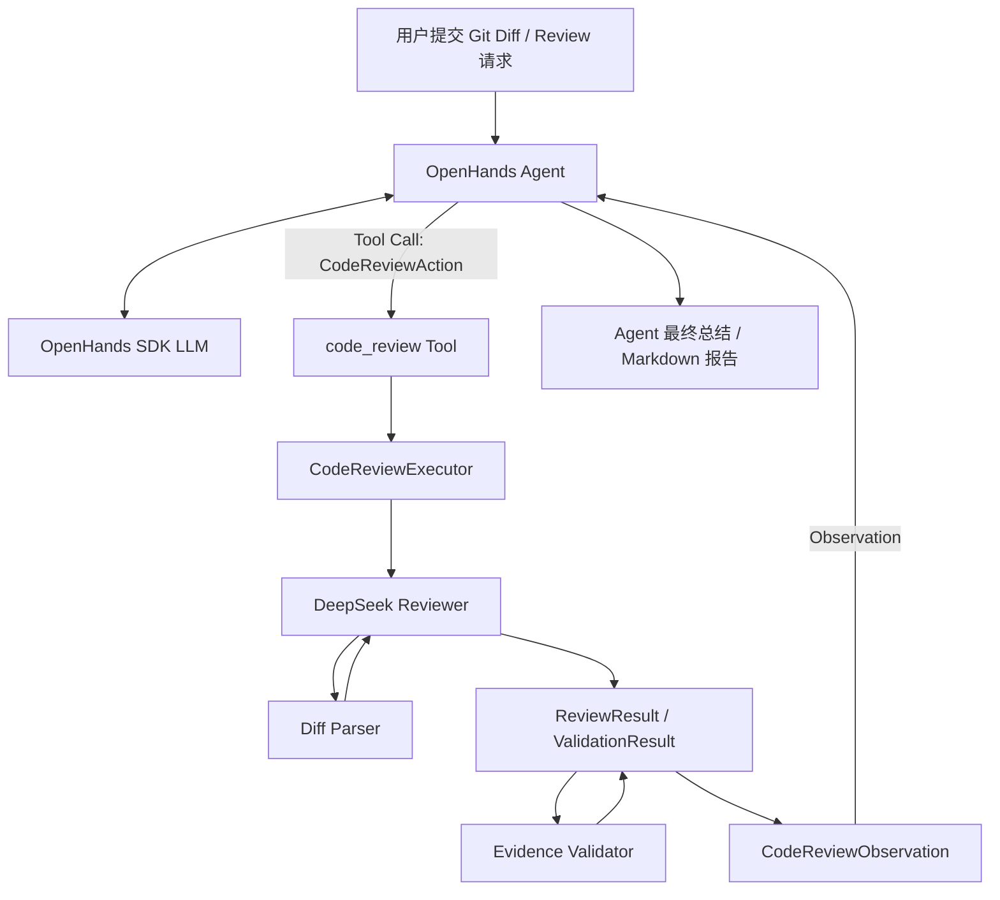
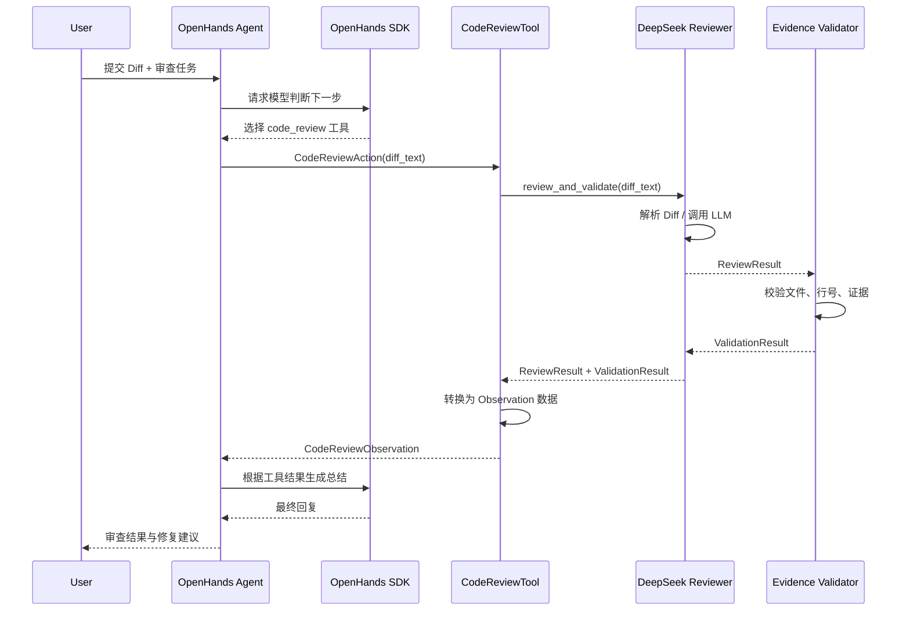

# OpenHands CodeReview Agent

基于 **OpenHands Software Agent SDK** 二次开发的 AI Code Review Agent。项目面向 Git Unified Diff，使用 LLM 识别潜在缺陷与安全风险，并通过证据校验降低无依据审查结果的比例。

> 当前项目处于 MVP / 求职项目打磨阶段。评估结果来自精选测试集，不代表对任意代码的普遍准确率。

## 1. 项目目标

输入 Git Diff，输出结构化审查结果：

- 风险类型与严重级别
- 文件路径与行号
- 问题描述及代码证据
- 修复建议
- 证据校验结果
- Markdown 审查报告

项目重点不是简单地把 Diff 发给聊天模型，而是构建一个包含 **Diff 解析、LLM 审查、证据验证、结构化结果和 Agent 工具调用** 的完整流程。

## 2. 功能

- **Unified Diff 解析**：识别新增、删除、上下文行，并维护新旧文件行号。
- **LLM Code Review**：通过 DeepSeek API（OpenAI-compatible API）进行代码审查。
- **结构化输出**：将审查结果映射到 `ReviewResult` / `ReviewFinding` 等数据结构。
- **证据校验**：检查发现的问题是否对应目标文件、有效行号及 Diff 中的新增代码证据。
- **结果报告**：输出审查摘要、有效发现、无效发现及 Markdown 报告。
- **OpenHands SDK 集成**：注册 `code_review` 自定义 Tool，让 OpenHands Agent 根据任务调用审查能力。
- **自动化测试**：覆盖 Diff parser、schema、evidence validator、report、metrics 与 SDK tool。

## 3. 架构图



### 模块职责

| 模块 | 职责 |
|---|---|
| `src/diff_parser.py` | 解析 Unified Diff、文件路径、hunk、行号与行类型 |
| `src/schemas.py` | 定义审查结果和 finding 的结构、字段约束 |
| `src/reviewer.py` | 调用 LLM、解析审查结果并串联验证 |
| `src/evidence_validator.py` | 校验 finding 的文件、行号和证据是否与 Diff 对应 |
| `src/report.py` | 将审查结果转换为 Markdown 报告 |
| `src/metrics.py` | 计算评估指标 |
| `src/openhands_adapter/code_review_tool.py` | OpenHands SDK 自定义 Action、Observation、Executor、Tool |
| `tests/` | 单元测试、集成测试与工具测试 |
| `run_eval.py` | 运行 curated evaluation cases 并输出评估结果 |

> 具体文件与模块名请以当前仓库实际内容为准；如果后续重构了模块，记得同步更新本表。

## 4. 执行流程图



### 核心执行链

```text
Conversation.run()
  └─ OpenHands Agent
      ├─ LLM 生成工具调用
      ├─ CodeReviewAction
      ├─ CodeReviewTool / CodeReviewExecutor
      │   └─ DeepSeekReviewer.review_and_validate()
      │       ├─ Diff 解析
      │       ├─ LLM 审查
      │       ├─ ReviewResult
      │       └─ Evidence Validator
      ├─ CodeReviewObservation
      └─ Agent 读取 Observation 并生成最终回答
```

## 5. 技术栈

- Python 3.12
- OpenHands Software Agent SDK
- DeepSeek API（OpenAI-compatible）
- `uv`：Python 环境与依赖管理
- `pytest`：自动化测试
- GitHub Actions：CI 自动测试 / AI Review 工作流

## 6. 项目结构

```text
CodeReviewAgent/
├── src/
│   ├── diff_parser.py
│   ├── schemas.py
│   ├── reviewer.py
│   ├── evidence_validator.py
│   ├── metrics.py
│   └── openhands_adapter/
│       └── code_review_tool.py
├── tests/
│   ├── test_diff_parser.py
│   ├── test_evidence_validator.py
│   ├── test_metrics.py
│   ├── test_report.py
│   ├── test_schemas.py
│   ├── test_reviewer_integration.py
│   └── test_openhands_code_review_tool.py
├── samples/
│   └── eval_cases.json
├── scripts/
│   └── test_openhands_agent.py
├── run_eval.py
├── eval_results.json
├── .env.example
└── README.md
```

## 7. 本地运行

### 环境要求

- Python 3.12
- `uv`
- DeepSeek API Key
- OpenHands SDK 依赖（项目当前通过 uv 管理）

### 安装依赖

```powershell
uv sync
```

如果 OpenHands SDK 使用本地 editable source 安装，请根据当前 `pyproject.toml` 配置确保 SDK 路径可用。

### 配置 API Key

复制 `.env.example` 为 `.env`，填入 API Key：

```dotenv
DEEPSEEK_API_KEY=your_api_key_here
LLM_MODEL=deepseek/deepseek-chat
LLM_BASE_URL=https://api.deepseek.com
```

**不要将 `.env`、真实 API Key 或其他密钥提交到 Git。**

PowerShell 当前会话也可以设置环境变量：

```powershell
$env:DEEPSEEK_API_KEY = "your_api_key_here"
$env:LLM_MODEL = "deepseek/deepseek-chat"
$env:LLM_BASE_URL = "https://api.deepseek.com"
```

### 运行测试

```powershell
uv run --with pytest python -m pytest -v .\tests
```

### 运行 OpenHands Agent 集成测试

```powershell
uv run python .\scripts\test_openhands_agent.py
```

该脚本会调用真实模型 API，可能产生 API 费用。

### 运行评估集

```powershell
uv run python .\run_eval.py
```

请以脚本当前参数与输出为准；运行后检查生成的评估结果文件。

## 8. 测试与评估

当前已验证：

- **30 项自动化测试通过**（最近一次本地回归测试）
- **15 个 curated evaluation cases**，当前精选集结果为 100%
- **真实 OpenHands Agent → 自定义 Tool → Reviewer → Observation → Agent 最终回复** 端到端调用成功
- GitHub Actions 中已验证测试 / AI Review 工作流

### 评估结果的解释

精选测试集用于验证已覆盖场景，包括典型缺陷和证据匹配规则。它不是随机抽样或生产环境数据，因此不能直接解释为“模型在所有代码上的准确率为 100%”。

建议后续增加：

- 不同语言、不同规模 Diff 的测试
- 无问题 Diff（false positive）场景
- 复杂多文件 / 多 hunk 场景
- 误报率、漏报率、Precision、Recall
- 不同 GPT / DeepSeek 模型的同一数据集对比
- API 延迟、token 消耗与成本统计

## 9. 设计取舍

### 为什么先做独立 Reviewer，再接入 OpenHands？

先验证核心审查能力，再接入 Agent SDK，可以将模型审查逻辑与 Agent 编排层解耦。这样既能独立测试 Reviewer，也能单独验证 SDK Tool 的 Action / Observation 适配。

### 为什么增加 Evidence Validator？

LLM 可能生成看似合理但无法在 Diff 中定位的 finding。证据校验可以过滤部分文件路径、行号或代码证据不匹配的问题，降低无效报告的输出风险。

证据校验并不能证明漏洞一定存在；它主要验证报告是否有可追溯的 Diff 证据。

### 为什么先不自动修改代码？

MVP 优先建立可靠的审查和验证闭环。自动修改代码会引入额外风险，包括修改正确性、权限控制、回滚与测试验证，因此暂不作为第一阶段目标。

## 10. 当前限制与后续计划

- 当前主要面向 Git Unified Diff 输入，不等同于完整仓库级静态分析。
- Evidence Validator 验证的是证据与 Diff 的对应关系，不是漏洞真实性的形式化证明。
- 模型输出质量受模型、提示词、Diff 上下文和 API 服务影响。
- 当前评估集规模有限，需扩充并建立更严格的人工标注基准。
- 后续可增加多模型评测、仓库上下文检索、PR 评论集成、人工反馈闭环与权限控制。

## 11. 简历项目描述（可按实际情况调整）

**OpenHands CodeReview Agent｜Python、OpenHands SDK、LLM、DeepSeek API**

- 基于 OpenHands Software Agent SDK 二次开发 Code Review Agent，设计并实现自定义 `Action / Observation / ToolExecutor / ToolDefinition`，打通 Agent 工具选择、执行、结果回传及最终总结流程。
- 实现 Unified Diff 解析与新增代码行号映射，构建结构化代码审查流程，输出风险类型、严重级别、代码证据及修复建议。
- 设计 Evidence Validator，对 finding 的文件路径、行号和代码证据进行校验，区分有效与无效审查结果，增强输出可追溯性。
- 建立 pytest 自动化测试与 curated evaluation 测试集；当前本地 **30 项测试通过**，精选评估集 **15/15** 通过（需在简历中注明为当前测试集结果）。
- 集成 GitHub Actions 自动化验证流程，支持代码变更后的测试与 AI Review。

> 简历数字应随仓库最新测试和评估结果更新。避免将精选测试集结果表述为普遍准确率。

## Demo

### 1. OpenHands Agent Tool Calling


### 2. SQL Injection Detection & Evidence Validation


### 3. Agent Final Review Report

